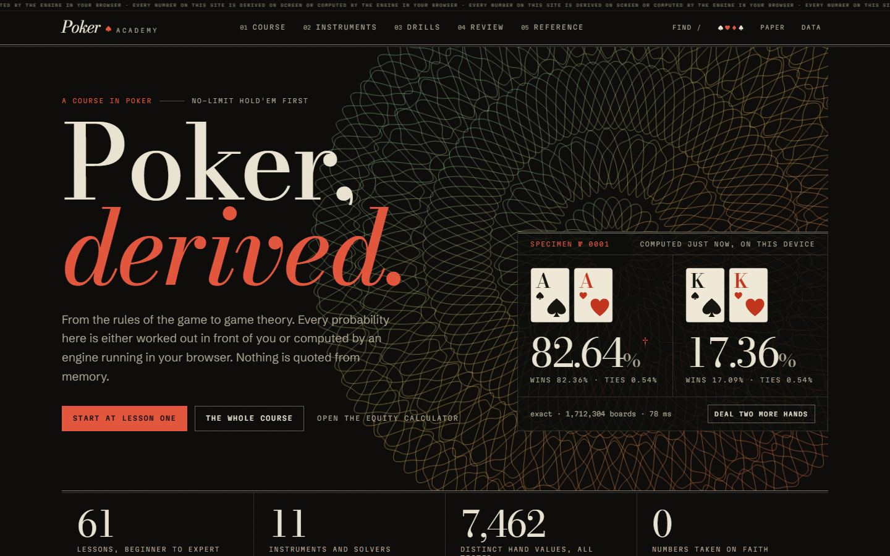
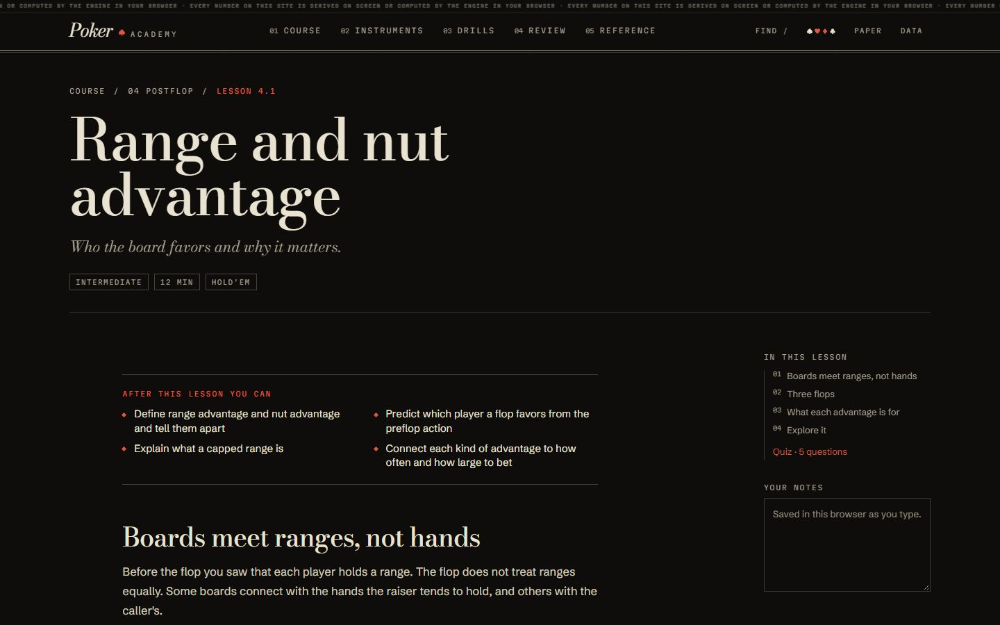
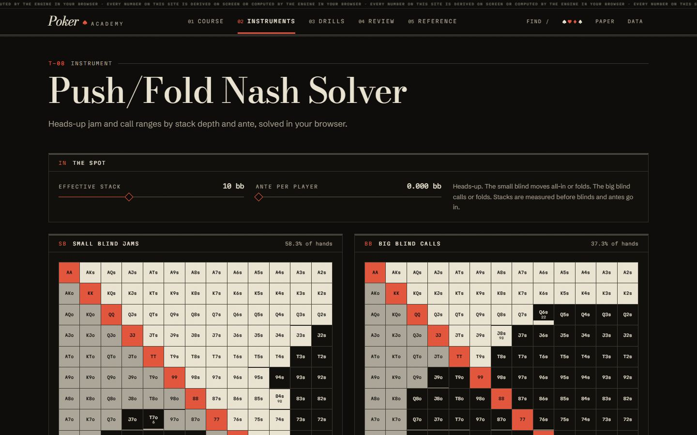
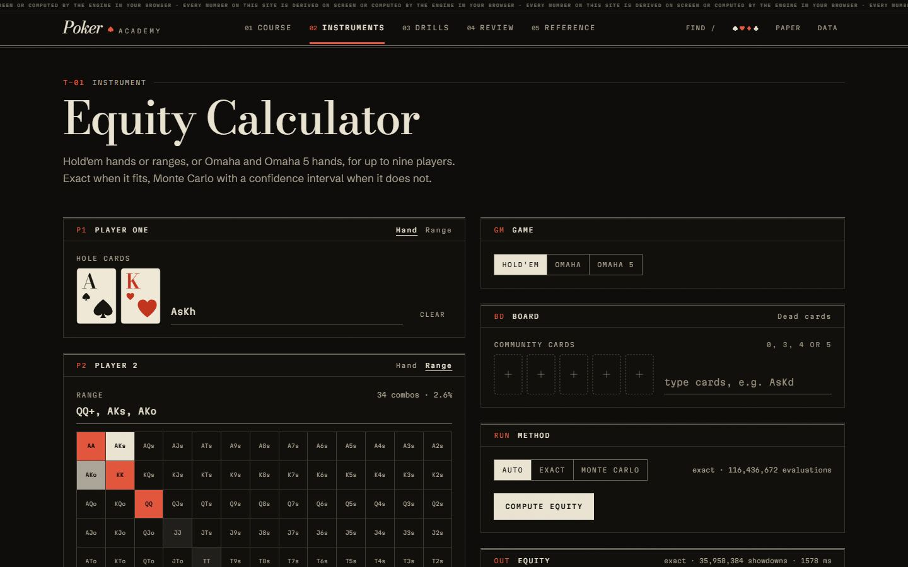

# Poker Academy

**Live site: https://ps12007.github.io/poker-academy/**

An interactive poker course: lessons from the rules to game theory, calculators, solvers and drills.
Every number on the site is derived on screen or computed by the engine in your browser. No backend, no account,
and it works offline after the first visit.



## What is in it

- **Course**: 61 lessons in nine modules. Basics, core math, preflop, postflop, game theory, tournaments,
  bankroll and the mental game, Pot-Limit Omaha, and other variants. Each lesson has live tools, worked examples,
  a Remember box and a quiz that feeds a spaced-repetition review queue.
- **Instruments**: equity calculator (Hold'em, Omaha, Omaha 5; exact or Monte Carlo with confidence intervals),
  range builder, range-vs-range heatmap, odds and outs, pot odds and EV, side pots, toy game lab (Kuhn poker CFR),
  heads-up push/fold Nash solver, ICM calculator, variance simulator, pot-limit calculator.
- **Drills**: ten endless, seeded trainers, from "which hand wins" to ICM bubble spots and Omaha wraps.
- **Reference**: glossary, printable cheat sheets, formula sheet and engine notes. Site-wide search with `/`.

| Lesson with live range equity | Push/fold Nash solver | Equity calculator |
|---|---|---|
|  |  |  |

## The engine

Pure TypeScript, no DOM, runs in Web Workers. The hand evaluator is verified against all 2,598,960 five-card and
all 133,784,560 seven-card hands, an independent reference evaluator and property tests. Equity is exact when the
enumeration fits and Monte Carlo (seeded, reproducible) when it does not. Kuhn poker CFR converges to the known
game value of -1/18, and the push/fold solver reports its own exploitability.

## Develop

```
npm install
npm run dev        # local site
npm test           # engine and content tests (about 310)
npm run build      # production build
npm run test:e2e   # Playwright smoke tests against the build
```

Pushing to `main` runs typecheck, lint, unit tests and the smoke tests, then deploys to GitHub Pages.
See `PLAN.md` for the build plan and `CLAUDE.md` for conventions and how to add lessons, tools and drills.
